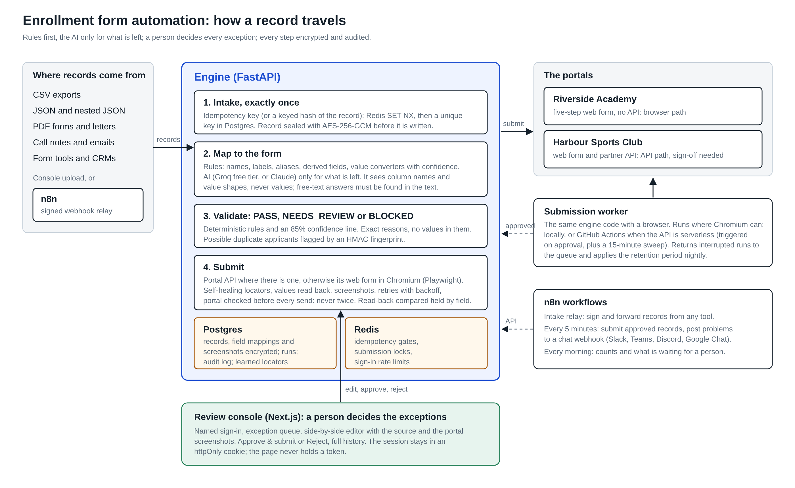

# AI-Powered Online Enrollment Form Automation System

Takes applicant records in whatever shape they arrive (spreadsheet exports, JSON, webhooks, PDFs, call notes),
maps them onto an enrollment form with rules first and AI only for what is left, checks every field with
deterministic rules, and submits to the target portal by API or through its web form in a real browser. Anything
uncertain stops in a review queue for a person. Every step is encrypted and audited.



## What it does

- **Ingest** CSV, JSON (nested too), fillable PDFs, letters, call notes and signed webhooks. The same record sent
  twice is stored once (Redis gate plus a unique key in Postgres).
- **Map** source columns to form fields by name, label and alias, convert values with an honest confidence
  (dates, phones, options, multi-selects), and call the AI (Groq free tier, or Claude) only when a required field is
  still missing. For structured records the AI sees column names and value shapes, never personal data; values it
  reads from free text must be found in the text.
- **Validate** into PASS, NEEDS_REVIEW or BLOCKED with exact reasons: required and conditional fields (guardian
  details for under-18s, a previous student ID), formats, age and date ranges, conflicting sources, a confidence
  line at 85%, possible duplicate applicants.
- **Submit** through the portal API, or its web form in Chromium (Playwright): custom dropdowns, date pickers,
  multi-step wizards. Every value is read back from the page, every page is screenshotted, locators heal when the
  page changes, temporary failures are retried with backoff, and the portal is checked before each send so a lost
  reply never becomes a second submission. A captcha stops the run for a person.
- **Review** in the console: an exception queue, a side-by-side editor with the source record and the portal
  screenshots, Approve & submit or Reject, run history and an audit log, under named reviewer sign-in.
- **Orchestrate** with n8n: a signed intake relay, a scheduled submitter with chat alerts, a morning digest.

## Results

24 synthetic records in realistic shapes, each with the values a careful person would enter ([details](docs/BENCHMARK.md)):

| | Rules only | Rules + AI |
|---|---|---|
| Fields mapped correctly | 92.7% | **100%** |
| Outcome as expected | 21 of 24 | **24 of 24** |
| Wrong values anywhere | 0 | **0** |

Real submissions while the portals fail on purpose: 13 of 13 submitted, every portal record matched what was sent,
5 of 5 recovered from failing or lost-reply portals, 0 duplicates, median 4.7 s by web form and 1.0 s by API.

## Stack

| Layer | Technology |
|---|---|
| Engine | Python 3.11+, FastAPI, Pydantic, asyncpg |
| Browser automation | Playwright (Python), Chromium |
| Console and practice portals | Next.js |
| Data | PostgreSQL (AES-256-GCM field encryption), Redis |
| AI mapping | Groq (free tier) or Claude, strict JSON schema |
| Orchestration | n8n, a submission worker |
| Hosting | free tiers: Vercel, Neon, Upstash, GitHub Actions |

## Run it locally

See [docs/SETUP.md](docs/SETUP.md). In short:

```bash
docker compose up -d                                   # Postgres, Redis, n8n
cd backend && python -m venv .venv && . .venv/bin/activate && pip install -r requirements-dev.txt
python -m playwright install chromium
python -m scripts.keys >> ../.env                      # then fill in the rest of .env from .env.example
uvicorn app.main:app --reload                          # engine on :8000
cd ../frontend && npm install && npm run dev           # console and portals on :3000
```

Try it with the files in [samples/raw](samples/raw/README.md).

## Tests

160 backend tests (rules, mapping with a recording fake AI, intake, the submission runner, security) against real
Postgres and Redis, 8 real-browser submissions to the running portals, and 39 Playwright tests for the portals and
the console including accessibility checks. CI runs them all on every push.

## More

- [How it works, in detail](docs/DETAILS.md)
- [Deploying on free tiers](docs/DEPLOY.md)
- [Benchmark](docs/BENCHMARK.md) and [n8n workflows](n8n/README.md)
